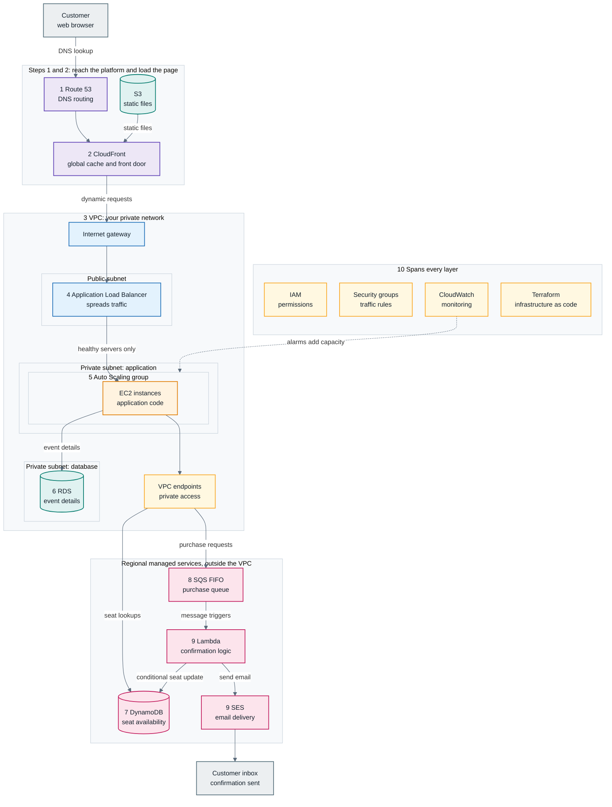
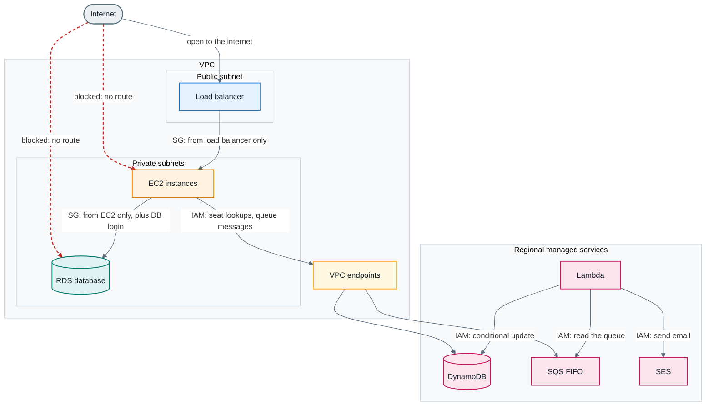
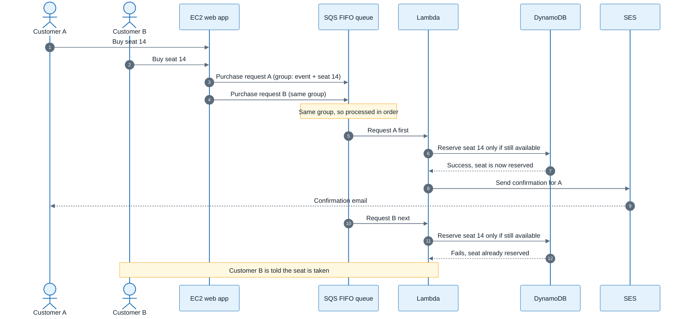

# AWS Architecture: Live Event Ticket Platform

Oct 14, 2026 · @Dev Bhargav

## 1. Overview

A live event ticket site needs only about 15 to 25 AWS services, and once you see how they connect you can explain a whole cloud system in an interview. This document follows one customer from typing the website address to receiving a confirmation email, in 10 steps.

A ticket platform is a hard test because a tour announcement sends millions of people to the site at once. Five things must hold under that load:

- The pages load quickly, wherever the customer is.
- The servers survive the sudden spike.
- The database answers thousands of requests a second.
- Two people can never buy the same seat.
- The customer gets a confirmation email straight away.

The idea to take away: you do not learn AWS by memorising services. You learn the problem each service solves. Every service in this design exists because without it something else breaks, and every technical choice has a business effect, such as a slow page losing a sale.

Source: the video transcript and architecture diagram you attached. Service behaviour is as the video describes it; check current AWS documentation before relying on details such as limits or pricing.

## 2. Complete architecture flowchart

Every request enters through Route 53 and CloudFront, passes the internet gateway and load balancer into private servers, and ends as a seat reservation and an email. The numbers match the markers on your diagram. If the chart shows as plain code, paste it into mermaid.live.

Purple is the global edge, blue the network, orange compute, teal storage, pink regional managed services and yellow the controls that span every layer. Only the internet gateway and load balancer face the internet; the servers and the database sit behind them.

### 2.1 Connection list

| From | To | What travels |
| --- | --- | --- |
| Customer browser | Route 53 | The DNS question for the site name |
| Route 53 | CloudFront | The answer that points to the platform |
| S3 | CloudFront | Static files, fetched on the first request from a region |
| CloudFront | Internet gateway | Dynamic requests the cache cannot answer |
| Internet gateway | Load balancer | Every request, through the one public door |
| Load balancer | EC2 | Each request, to a healthy server |
| EC2 | RDS | Event detail queries; the security group allows EC2 only |
| EC2 | DynamoDB, via VPC endpoint | Seat status lookups |
| EC2 | SQS FIFO, via VPC endpoint | Purchase requests grouped by event and seat |
| SQS | Lambda | A message triggers the function |
| Lambda | DynamoDB | Conditional update: reserve only if still available |
| Lambda | SES | The call to send the confirmation |
| SES | Customer inbox | The confirmation email |
| CloudWatch | Auto Scaling group | An alarm that tells it to add capacity |

## 3. The customer journey in 10 steps

Each step adds one service that solves one problem, and the numbers match the numbered markers on your diagram.

| Step | Service | Problem it solves | Connects to |
| --- | --- | --- | --- |
| 1 | Route 53 | Turns the website name into the IP address the browser needs (DNS) | Sends the customer to CloudFront |
| 2 | CloudFront and S3 | Static files (images, layout, styling) load slowly if every visitor reaches the home region | S3 holds the files; CloudFront caches copies at edge locations near customers |
| 3 | VPC with public and private subnets | Servers and databases must not be open to the internet | Internet gateway is the only door in |
| 4 | Application Load Balancer and Auto Scaling group | One server cannot take millions of requests, and a fixed number of servers cannot follow the spike | Sits in the public subnet and forwards to EC2 |
| 5 | EC2 | Runs the application code that works out dynamic pages | In a private subnet; reached only through the load balancer |
| 6 | RDS | Event details (artist, venue, dates, seating map, pricing) are connected data that suits tables | Private subnet; only EC2 may query it |
| 7 | DynamoDB | Seat availability checks run thousands of times a second and need fast keyed lookups | Regional service outside the VPC; EC2 reaches it privately |
| 8 | SQS FIFO queue | Several people may click buy on the same seat at once | EC2 adds purchase requests; Lambda reads them |
| 9 | Lambda and SES | The confirmation email should not add load to the busy servers | Lambda updates DynamoDB, then calls SES to email the customer |
| 10 | Security groups, IAM, CloudWatch, Terraform | Every connection must be locked down, watched and repeatable | Spans every layer |

The path in one line: browser to Route 53 to CloudFront (static files from S3), then through the internet gateway to the load balancer, to EC2, which reads RDS and DynamoDB and queues purchases in SQS; Lambda finishes the purchase and SES sends the email.

## 4. Service reference

Five of these services (S3, DynamoDB, SQS, Lambda and SES) are regional managed services that sit outside the VPC; the others are global, at the edge, or inside the network.

| Service | What it is | Where it sits | Why it is used here |
| --- | --- | --- | --- |
| Route 53 | DNS: translates a website name to an IP address | Global | Sends customers to the platform |
| CloudFront | Content delivery network with copies at edge locations | Edge locations worldwide | Fast static files, and a front door for dynamic requests |
| S3 | Cheap, reliable file storage | Regional, outside the VPC | Holds images, layouts, maps and styling |
| VPC | Your own isolated network inside AWS | Region | Keeps servers and databases private |
| Internet gateway | The door between the VPC and the internet | Edge of the VPC | Only entry point for customer traffic |
| Application Load Balancer | Spreads requests across healthy servers | Public subnets, at least two availability zones | The single door customers reach |
| Auto Scaling group | Adds and removes servers as load changes | Private subnets | Handles the spike without paying for idle machines |
| EC2 | Virtual computers you configure | Private subnet | Runs the application code continuously |
| RDS | Managed relational database (tables) | Private subnet | Connected event data; only EC2 can reach it |
| DynamoDB | Managed NoSQL database with keyed records | Regional, outside the VPC | Fast seat status lookups and safe seat updates |
| SQS FIFO | Message queue that keeps order within a message group | Regional, outside the VPC | Orders competing purchases for the same seat |
| Lambda | Code that runs only when triggered | Regional, outside the VPC | Processes each purchase, then builds the email |
| SES | Email sending at scale | Regional, outside the VPC | Delivers the confirmation email |
| VPC endpoints | Private path from the VPC to AWS services | Edge of the VPC | Lets servers reach DynamoDB and SQS without the internet |
| Security groups, IAM | Network door rules and per-service permissions | Every layer | Lock down who connects and what each service may do |
| CloudWatch | Metrics, logs, dashboards and alarms | Every layer | Shows system health and triggers scaling or alerts |
| Terraform or CloudFormation | Infrastructure described in files | Outside the system | Rebuilds identical environments from a file |

## 5. Network and security

Every connection in this design is allowed on purpose: if a path was not explicitly opened, it does not exist. Three layers do this work, and the diagram below shows which paths are open and which are blocked.

**The network boundary.** A VPC is your own isolated network inside AWS, like a private floor in a shared building. Inside it, subnets organise the space. **Public subnets** have a route to the internet through the internet gateway, so they hold what must receive internet traffic, such as the load balancer. **Private subnets** have no direct route from the internet, so they hold the application servers and the database.

**Security groups** are rules on the door of each component, controlling what may come in and go out.

- The load balancer's door is open to the internet, because that is how customers reach the site.
- The EC2 door opens only to traffic from the load balancer.
- The RDS door opens only to traffic from EC2.

**IAM** controls what each service may do once connected, like a key card that opens only the doors a job needs.

- EC2 may look up seats in DynamoDB and send messages to SQS. It cannot delete tables or reach S3 buckets.
- Lambda may read from SQS and call SES to send email. It cannot update or delete anything else.
- RDS needs a second checkpoint: IAM covers AWS-level permissions, but logging into the database uses a database username and password, so EC2 needs both network access and credentials.

**VPC endpoints** give private servers a way to reach DynamoDB and SQS without the internet. Private does not mean cut off: the internet cannot reach in, but the servers can still reach out to the services they need.

Red dashed lines are paths that do not exist. Even if one layer is compromised, the blast radius stays small because of database credentials, IAM permissions, secrets management, logging and least-privilege access.

## 6. Buying a seat without double selling

Two mechanisms together stop two people buying the same seat: an SQS FIFO queue controls the order of competing attempts, and a DynamoDB conditional update makes the real decision.

The risk is double selling. If three people click buy on seat 14 at almost the same moment and each request checks DynamoDB, all three see the seat as available, all three reserve it, and three people believe they own it.

Purchases for different seats sit in different message groups, so they still run in parallel.

| Approach | What happens | Result |
| --- | --- | --- |
| Check availability, then mark reserved as a separate step | Another request can read the same seat in the gap between the two steps | Double selling is possible |
| One conditional update: reserve only if currently available | DynamoDB checks and updates as a single action | The first request wins; later ones fail at once |

The queue controls the flow; the conditional update is the real protection. The queue also decouples the system: if processing goes down for a few minutes the messages wait, and the part that receives purchases and the part that processes them can fail independently.

## 7. Scaling, resilience and monitoring

The design survives a spike because each layer scales or buffers on its own, and CloudWatch shows when any of them struggles.

| Concern | How the design handles it | Service |
| --- | --- | --- |
| Slow pages for distant customers | The first request from a region fetches files from S3 and caches a copy at the nearest edge location; later requests are served from the edge | CloudFront |
| One door, many servers | Requests are spread across healthy servers; a server that stops responding gets no traffic | Application Load Balancer |
| Loss of one data centre | The load balancer sits in public subnets in at least two availability zones | Application Load Balancer |
| Not enough servers | When load is high (the video's example is 70 to 80 percent capacity) more servers launch; extras are removed when it calms | Auto Scaling group |
| Processing goes down briefly | Purchase messages wait in the queue and are processed when it returns | SQS |
| Idle cost | Code runs only when a message arrives, and costs nothing otherwise | Lambda |
| Repeating an environment | One file describes every service, its settings and permissions, and changes can be tracked | Terraform or CloudFormation |

A load balancer does not create servers. It only spreads traffic across the ones that exist, so it needs the Auto Scaling group beside it. Without autoscaling you are stuck with a fixed number of servers; without load balancing all traffic hits one server and the rest sit idle.

### Monitoring with CloudWatch

- **Metrics and logs:** EC2 CPU use, load balancer request counts, errors, latency and application logs.
- **Business metrics:** the application can publish custom metrics such as tickets per minute.
- **Real user speed:** CloudWatch RUM shows what customers experience in the browser.
- **Dashboards:** one control-room view of every part of the system.
- **Alarms:** a spike in errors notifies the team, and some alarms can trigger autoscaling to add capacity without anyone acting.

## 8. Choosing between similar services

The design uses two tools for several jobs, because each tool fits a different kind of work. In an interview, be ready to say which problem a service solves and why you chose it over the alternative.

| Choice | Use the first when | Use the second when | In this design |
| --- | --- | --- | --- |
| EC2 or Lambda | Work runs continuously and needs a full server environment | Short tasks fire on an event, run, and stop | EC2 runs the web application; Lambda processes purchases and builds emails |
| RDS or DynamoDB | Data is connected and stored in tables | Millions of simple, fast keyed lookups and safe updates at scale | RDS holds event details; DynamoDB holds seat status |
| EC2 or containers (ECS, EKS) | You want full control and the simplest compute layer to learn | You want easier packaging, deployment and consistent scaling across environments | EC2 with Auto Scaling, to keep the beginner design simple |
| S3 alone or S3 with CloudFront | Customers are close to the bucket's region | Customers are spread across the world | S3 with CloudFront in front |

The video notes that the whole platform could run in containers; EC2 was chosen only because it makes the compute layer easier to understand.

## 9. Interview talking points

You can explain this whole system in under a minute by following the customer and naming the problem at each hop.

**The one-minute version.** "A customer's browser asks Route 53 for the address and reaches CloudFront, which serves static files cached from S3 at the nearest edge location. Dynamic requests enter our VPC through the internet gateway to an Application Load Balancer in a public subnet. The load balancer spreads traffic across EC2 instances in private subnets, which an Auto Scaling group grows and shrinks. The servers read event details from RDS and seat status from DynamoDB. Purchases go into an SQS FIFO queue, grouped by event and seat, and a Lambda function reserves the seat with a conditional DynamoDB update, then calls SES to send the confirmation. Security groups and IAM lock down every connection, CloudWatch monitors it, and Terraform builds it."

**Questions to be ready for**

- Why is the database in a private subnet? So the internet cannot reach it; only the application servers can, through the security group, and they also need database credentials.
- How do you stop two people buying one seat? The queue orders attempts per seat, and DynamoDB marks the seat reserved only if it is still available, as one action. The first request wins and later ones fail.
- Why split RDS and DynamoDB? RDS suits connected event data; DynamoDB suits millions of fast seat lookups.
- What happens if processing goes down? Messages wait in SQS and are processed on return, because receiving and processing are decoupled.
- Why Lambda for the email? It adds no load to the busy servers and costs nothing when no one is buying.
- Is private the same as cut off? No. The internet cannot reach in, but servers reach AWS services over VPC endpoints without the traffic leaving the AWS network.
