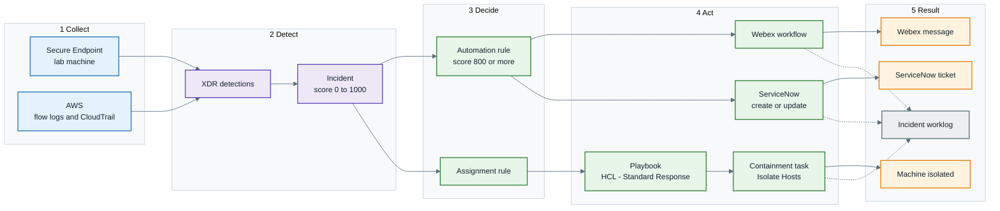
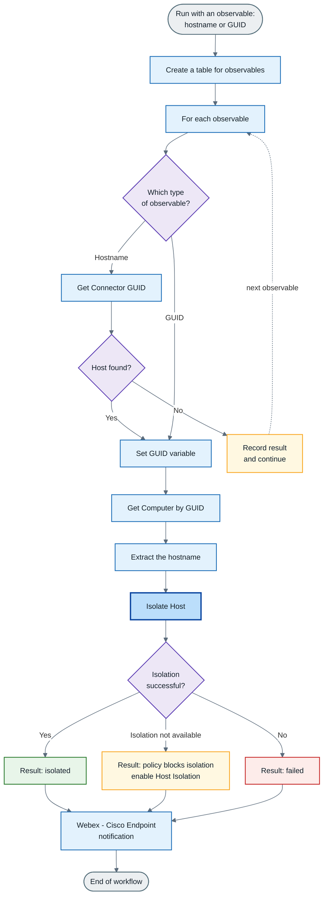
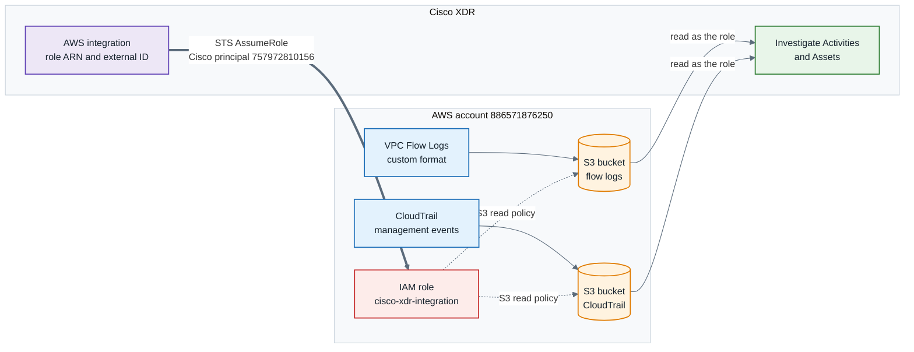
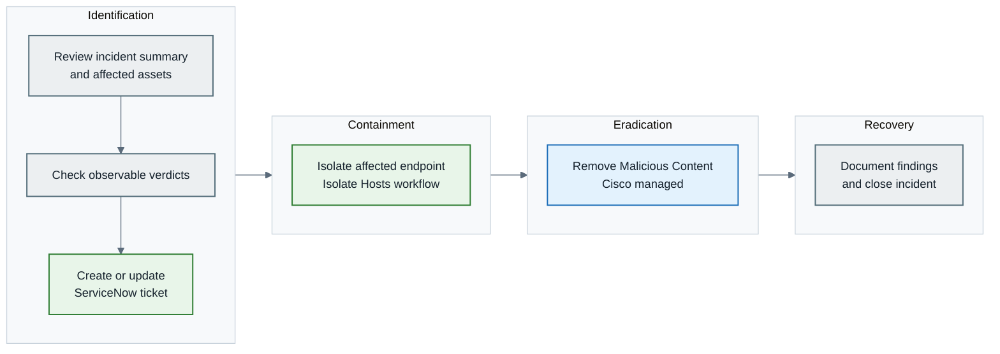

# Cisco XDR PoV: Complete Build and Recreation Report

Oct 14, 2026 · @Dev Bhargav

## 1. Purpose and how to use this report

This report records everything built in the HCL Cisco XDR proof of value (PoV), in the order it was built, so you can rebuild it alone and map each piece to a row of the deliverables sheet.

1. Read section 2 and gather every account and credential it lists.
2. Look at the diagram in section 3 to see how the parts connect.
3. Use section 4 to see which sheet row each piece proves and where it stands.
4. Build in order with sections 5 to 10. Each one lists the clicks, the values and the traps.
5. Prove each piece with section 11, and use section 12 when something fails.
6. Collect the evidence in section 13 before changing a row to "Met" in the sheet.

**Status words used throughout.** **Proven**: it ran and you saw the result. **Built**: configured, not yet confirmed. **Partly done**: some of the row is covered. **In progress**: being worked on. **Blocked**: waiting on something outside XDR. **Unconfirmed**: tried, result not checked.

Menu names and field labels in XDR change between releases. Where a label differs on your screen, follow the description of what the step does. No passwords, tokens or keys appear here; keep them in your own password manager.

Source: the project documents in the XDR project (build guide, work summary, R.A.W build pack, AWS guides) and the working session notes.

### Status at a glance

| Area | Status | What is left | Section |
| --- | --- | --- | --- |
| Workflows and automation rule | Proven | Tidy the rule's title, condition and type | 6.1 |
| Custom playbook and assignment rule | Built | Walk a new incident through every task | 6.2 |
| Containment with Secure Endpoint | Proven | Map outputs, add to the playbook, capture evidence | 7 |
| Webex notification | Proven | Replace placeholder text in the message | 8.1 |
| ServiceNow ticketing | Built | Run on a test incident and check for duplicates | 8.2 |
| AWS integration | Built | Get flow log and CloudTrail data to appear | 9 |
| AI agent | In progress | Finish the form and test on an incident | 10 |
| Jira | Unconfirmed | Confirm the fix or retire it | 8.3 |
| Email | Blocked | Needs an SMTP account that allows sign-in | 8.4 |

## 2. Environment and prerequisites

The work runs on one tenant, `xdr.apjc.security.cisco.com` (Asia-Pacific, Japan and China region), with an Advantage licence, and needs the accounts below before any workflow will validate.

| Item | What you need | Used for | Status |
| --- | --- | --- | --- |
| Cisco XDR account | Role allowed to create workflows, rules, playbooks and integrations | Everything | Proven |
| Webex | A bot from developer.webex.com, its access token, and a space the bot has joined | Notifications | Proven |
| ServiceNow | Developer instance `dev453866.service-now.com`, user `xdr_integration` with the `itil` role | Ticketing | Built |
| Jira Cloud (alternative) | Site URL, account email, API token, project key, issue type | Ticketing | Unconfirmed |
| Email (SMTP) | SMTP host, port and a login that allows SMTP AUTH | Email notification | Blocked |
| Cisco Secure Endpoint | Console API credentials with Read and Write scope, a connector on a test machine, Host Isolation enabled in that machine's policy | Containment | Proven for the isolate run |
| AWS | Account `886571876250`, an IAM role `cisco-xdr-integration`, the XDR Organization ID as external ID, S3 buckets for logs | Cloud telemetry | Built, no data yet |
| Test machine | A lab machine with the Secure Endpoint connector, on a separate network | Containment and detection tests | Proven |

Region endpoints used for API work: `visibility.apjc.amp.cisco.com/iroh/` and `automate.apjc.security.cisco.com/api/`.

Every workflow reaches an outside system through a **target** (where to connect) and an **account key** (the stored credentials). Create the integration first, then the target, then the workflow. Without them the workflow will not validate.

## 3. Architecture at a glance

A high-priority incident follows two paths at once: an automation rule runs the Webex and ServiceNow workflows immediately, and an assignment rule attaches the playbook that the analyst follows. The diagrams below are Mermaid source; if one shows as plain code, paste it into mermaid.live.

### 3.1 End-to-end flow



Blue boxes are data sources, purple is XDR's own analysis, green is automation you built, orange is the visible result and grey is the record. The containment task acts on the same machine that produced the detection.

### 3.2 Containment workflow



Both entry points join at the GUID, so a hostname and a GUID share the same lookup and isolation steps. The heavy blue box is the only step that changes anything on the machine.

### 3.3 AWS data path



XDR never holds AWS keys. It assumes the role, so a wrong ARN or external ID stops everything at the thick arrow, before any data is read.

### 3.4 Playbook phases



Grey tasks are done by the analyst, green tasks run a workflow, and the blue task is Cisco-managed. The phases are fixed; only the tasks inside them are yours.

### 3.5 Who starts what

| Trigger | Starts | Result |
| --- | --- | --- |
| Incident created at or above the threshold | Automation rule | Webex message and ServiceNow ticket |
| Incident created | Assignment rule | Playbook attached to the incident |
| Analyst reaches the Containment task | Playbook task | Isolate Hosts workflow runs |
| Analyst runs it by hand with an observable | Manual run | Isolate Hosts workflow runs |

## 4. Mapping to the deliverables sheet

The work covers the four R.A.W rows, plus parts of Integration, Incident Management and AI. Rows you did not work on are left out. Level of Importance and Requirement Met are still blank in the sheet, so agree levels with HCL before marking anything Met.

### Response, Automation, Workflow (R.A.W)

All four rows target AR (Accelerate Response).

| Sheet row | Status | What you did | Section |
| --- | --- | --- | --- |
| Create Ticket (ServiceNow) | Built | Created the developer instance and the `xdr_integration` user, and chose the Cisco-managed "Create or Update Ticket for Incident" workflow. The test run is still to confirm. | 8.2 |
| Complete Containment Workflow | Proven | Ran a copy of the Cisco-managed "Secure Endpoint - Isolate Hosts" workflow on the lab machine. Host isolation only. | 7 |
| Create a Trigger (priority score above 800) | Partly done | The automation rule fired and started the workflow, and the Webex message works. Email is blocked. | 6.1, 8 |
| Create a Custom Playbook | Built | Published `HCL - Standard Response` with four phases and created its assignment rule. A full walk-through is pending. | 6.2, 6.3 |

### Integration

Both rows target DS, PI, SI and AR (Detect Sooner, Prioritize by Impact, Speed up Investigation, Accelerate Response).

| Sheet row | Status | What you did | Section |
| --- | --- | --- | --- |
| Integrate with Endpoint Solution | Partly done | Integrated Cisco Secure Endpoint and used it for isolation. The sheet names CrowdStrike, so confirm which product HCL expects. | 7 |
| Integrate with Public Cloud Infrastructure | Built | Added the AWS role, VPC Flow Logs and CloudTrail. Data is not yet appearing in Investigate or Assets. | 9 |

### Incident Management (I.M)

| Sheet row | Status | What you did | Section |
| --- | --- | --- | --- |
| Investigate Incident | Partly done | Opened and previewed incidents; INC-18 was used for the Webex message tests. | 8.1 |
| Complete Incident Lifecycle to Closure | Partly done | Built the custom playbook. Closing an incident through every task is still to do. | 6.2 |
| Review Incident Worklog | Partly done | Run history shows the rule as the starter of each workflow run. The closed-incident worklog review is pending. | 6.1 |

### Artificial Intelligence (A.I)

| Sheet row | Status | What you did | Section |
| --- | --- | --- | --- |
| Use the AI assistant to interact with an incident (marked Roadmap in the sheet) | In progress | Worked through the agent creation form. Use on an incident is not yet confirmed. | 10 |

### Supporting work

| Item | Status | Used for |
| --- | --- | --- |
| Webex notification | Proven | Telling the response team about a new incident |
| Jira Cloud | Unconfirmed | Alternative ticketing; the first run failed on two field values |
| Email notification | Blocked | Priority-score email; blocked by SMTP sign-in |

The AWS beginner guide, the AWS setup request for the cloud team and this report are the written outputs.

## 5. Foundations: targets, account keys and a first workflow

Build the Hello-XDR workflow first: it needs no outside system, so only your logic can fail, and it teaches the editor and the run view.

**Key terms**

| Term | Meaning |
| --- | --- |
| Workflow | A flowchart of steps that does one job |
| Activity | One step in the flowchart |
| Atomic action | A prebuilt single step for a product, such as one Secure Endpoint call |
| Target | A saved connection to an outside system |
| Account key | The stored credential a target uses |
| Variable | A named value: Input (passed in), Output (returned), Local or Static (inside) |
| Intent | The workflow type chosen at creation: Incident Response, Observable action, or general |
| Observable | An IP, domain, hash, hostname or similar indicator |

**Hello-XDR (proven)**

1. Go to Automate, then Workflows, then New workflow. Name it `Hello-XDR` and use a general intent.
2. Declare four variables: `name` (input), `ip` (input), `is_private` (local), `message` (output). An undeclared variable makes validation fail.
3. Add a condition on `ip` that checks for the private ranges `10.`, `192.168.` and `172.16.` to `172.31.`.
4. On each branch set `message`, inserting values with the `(x)` variable picker, or type `$` to search by name.
5. Click Validate and fix any red errors. Then Run it with test values and open each step in the run view to read its inputs and outputs.
6. Run again with `8.8.8.8` to prove the other branch.

**Variable picker**

The picker has five columns of sources: Activities (outputs of earlier steps), Env, Global, Incident response and Workflow. In a step's output you can choose fields such as Output, Row Count, Start time, End time or Elapsed time. Inside an array, Items is every row, First and Last are single rows, and Columns lists the names. A greyed entry means its type does not fit the field you are editing.

**Rule-Test workflow (proven)**

This is the smallest useful Incident Response workflow, used to prove rules and playbooks can start work.

1. New workflow, intent **Incident Response**, name `Rule-Test`.
2. Add one **Set Variables** step that writes a short message, for example the incident title.
3. Validate, install, run once by hand, then open the run and confirm each step passed.

**Two habits that save time**

- Read the child step when a run fails. The parent run only says that something went wrong.
- Leave **Continue workflow execution on failure** unticked while testing. When it is ticked, a failed step looks like a success.

## 6. R.A.W: the automation rule, assignment rule and playbook

Two separate mechanisms respond to a new incident: an **automation rule** acts instantly, and an **assignment rule** attaches a **playbook** that an analyst follows. Build them in this order.

### 6.1 Automation rule (sheet row: Create a Trigger)

1. Go to Automate, then Automation Rules, then New Rule.
2. Set the trigger to **incident created** (or the status change you want).
3. Add a condition on **priority score** at or above your threshold, for example 800. The score runs from 0 to 1000.
4. Under Workflows add `Rule-Test`, then later the Webex and ServiceNow workflows.
5. Choose the rule type. **Standalone** rules run on their own. **Priority** rules are evaluated in order and can stop later rules, so use standalone unless you need that ordering.
6. Save and enable it.

**Prove it fires.** Set the threshold low (for example 100) so an existing or new incident matches. Open the workflow's Runs page and confirm a run with that incident ID and the rule as starter. Then raise the threshold to 800 and note which incident exceeds it.

**Tidy-up still to do.** Make the rule's title, condition and description agree; an earlier rule still said "Runs Rule-Test" after its condition changed. The rule was also switched from standalone to priority and should go back.

### 6.2 Playbook (sheet row: Create a Custom Playbook)

A playbook is the analyst's checklist, split into four fixed phases: Identification, Containment, Eradication and Recovery. You add tasks inside each phase. A task is **manual** (the analyst does it) or **automated** (it runs one workflow). Cisco-managed tasks can sit beside your own.

1. Go to Automate, then Playbooks, then New Playbook. Name it `HCL - Standard Response`.
2. Add the tasks below, then Save and Publish. Publishing locks that version; later changes need a new version.

| Phase | Task | Type | Workflow |
| --- | --- | --- | --- |
| Identification | Review incident summary and affected assets | Manual | none |
| Identification | Check observable verdicts | Manual | none |
| Identification | Create or update ServiceNow ticket | Automated | ServiceNow - Create or Update Ticket for Incident |
| Containment | Isolate affected endpoint | Automated | Cisco Secure Endpoint - Isolate Hosts By Dev Bhargav |
| Eradication | Remove Malicious Content | Cisco managed | managed task |
| Recovery | Document findings and close incident | Manual | none |

The first version also held a "Run test workflow" task using `Rule-Test` to show that tasks can run workflows. Drop it once the real tasks work.

**Rules for tasks**

- A task runs **one** workflow, so ticketing and containment are separate tasks.
- The workflow must be validated and, in some versions, enabled for incident response before it appears in the task picker.
- A playbook task passes the incident's observables to the workflow, so the incident needs a hostname or GUID observable for containment to act.
- Keep Webex in **either** the rule **or** the playbook. In both, the room gets two messages for one incident.
- Many teams make the isolation task manual so an analyst presses Run. That is safer; keep it automatic only if the PoV needs full automation.

### 6.3 Assignment rule

An assignment rule decides which playbook is attached to a new incident. Create one that attaches `HCL - Standard Response` to incidents you care about, for example by priority. **It applies only when the incident is created**, so old incidents never receive the playbook. Test with a new incident.

### 6.4 Suggested description text

- **Rule:** Runs for incidents with priority score above 800 to notify the response team and start automated steps.
- **Playbook:** Standard triage, containment and closure steps for the HCL PoV. Guides an analyst through identification, containment, eradication and recovery.
- **Contain task:** Isolate the affected endpoint after approval and record the result in the worklog.

### 6.5 Recommended wiring

| Piece | Job | Starts when |
| --- | --- | --- |
| Automation rule (standalone) | Webex message and ServiceNow ticket | Incident created at or above the threshold |
| Assignment rule | Attaches the playbook | Incident created |
| Playbook | Analyst checklist and containment | Attached by the assignment rule |

Use the **Create or Update** ServiceNow workflow in both the rule and the playbook. If both run it, the second run updates the existing ticket and does not create a duplicate.

## 7. Containment with Cisco Secure Endpoint

The containment workflow isolates a machine through Cisco Secure Endpoint from an observable (hostname or connector GUID), and the isolate run on the lab machine was reported successful.

### 7.1 Prerequisites

1. In the Secure Endpoint console create API credentials with **Read and Write** scope. Whoever has console access does this.
2. In XDR go to Administration, then Integrations, and add Secure Endpoint with those credentials. Confirm it shows Connected and a target exists.
3. Install the Secure Endpoint connector on the lab machine. The machine can sit on a different network as long as it can reach Cisco's cloud.
4. In the policy applied to that machine, enable **Host Isolation**. Without it the workflow reaches the "Isolation not available" branch.

### 7.2 Build the workflow

1. Open Exchange and install the Cisco-managed **Cisco Secure Endpoint - Isolate Hosts** workflow. Copy it to your own tenant version, here named `Cisco Secure Endpoint - Isolate Hosts By Dev Bhargav`.
2. On the install page choose your Secure Endpoint target, then validate.
3. The workflow follows this path for each observable:

| Step | What it does |
| --- | --- |
| Create a table for observables | Builds a table from the observables passed in |
| For each observable | Loops over each row |
| Which type of observable is this? | Branches on Hostname or GUID |
| Hostname branch | Runs Get Connector GUID, asks "Was a host found?", and sets the GUID variable on Yes or records a result and continues on No |
| GUID branch | Sets the GUID variable directly |
| Get Computer by GUID | Looks up the machine |
| Extract the hostname | Pulls the name from the lookup |
| Isolate Host | Sends the isolation request |
| Isolation successful? | Yes, Isolation not available, or No; each updates the workflow result |
| Webex - Cisco Endpoint | Child workflow that posts the outcome |

### 7.3 Run it

1. Click Run and add an observable. Use the **hostname** (run `hostname` in a command prompt on the lab machine) or the connector **GUID**.
2. Open the run, click the For each iteration, and check three things: Get Computer by GUID returned a computer, Isolate Host returned a response, and which branch of "Isolation successful?" ran.
3. Confirm on the machine: the Secure Endpoint app shows isolation, or network access stops. It can take a minute or two.

**Finding the GUID without console access.** Read it in the connector app's settings or about view (look for a GUID, UUID or Connector ID field), generate the connector support package, or search the hostname in Investigate in XDR and read the endpoint's GUID from the result. The hostname route is simplest, because XDR resolves it itself.

**Why the output shows `{}`.** The workflow only sets variables. A run's output lists variables marked as workflow outputs, and none are, so the output is empty even on success.

### 7.4 Variables to add

Create these in the Variables panel and fill them with Update variable steps beside the existing result steps.

| Variable | Scope | Set it from | Why |
| --- | --- | --- | --- |
| `incident_id` | Input, optional | Playbook or rule | Links the action to the incident |
| `hostname` | Output | Extract the hostname step | Shows in Webex and tickets |
| `computer_ip` | Output | Get Computer by GUID | Evidence |
| `os_version`, `connector_version` | Output or Local | Get Computer by GUID | Evidence |
| `policy_name` | Output | Get Computer by GUID | Explains "isolation not available" |
| `last_seen` | Output | Get Computer by GUID | Shows whether the host was online |
| `isolation_status` | Output | Isolate Host response | One value: isolated, not\_available or failed |
| `error_message` | Output | Failure branches | Fast troubleshooting |
| `unlock_code` | Output, sensitive | Isolate Host, if returned | Needed to release the host |
| `timestamp` | Local | Format Date | Evidence trail |

> **Handle with care.** Keep `unlock_code` out of Webex and email; put it in the ticket work notes. Field names in the picker depend on what Get Computer by GUID returns, so open a successful run and use the picker to see them.

### 7.5 Reverse and approvals

Build or install a stop-isolation workflow so the lab machine can be restored after each test. If an unlock code was returned, it is needed here. For production, add an approval step before Isolate Host and a protected-hosts list for domain controllers and core servers.

### 7.6 Attach to the playbook

In the Containment phase of `HCL - Standard Response`, add an automated task that runs this workflow (section 6.2).

### 7.7 What is still open

- The sheet names CrowdStrike for containment; this build uses Secure Endpoint. Confirm with HCL which one they expect.
- Capture evidence: the workflow run, the isolated machine, the console showing isolation, and the reversal.

## 8. Notifications and ticketing: Webex, ServiceNow, Jira, email

Webex is the only notification path proven so far; ServiceNow is the chosen ticketing route, and Jira and email remain open.

### 8.1 Webex (proven)

1. At developer.webex.com create a **bot** and copy its access token. Add the bot to your Webex space; it can only post where it is a member.
2. In XDR go to Administration, then Integrations, enable Webex and save the token as the account key.
3. In Automate, then Targets, check a Webex target exists. "No valid account key" means the integration is not connected yet.
4. Open Exchange, install **Webex - Send Message for New Incidents**, and fill **Sources** and **Webex Room Name**.
5. Pick your Webex target when warned. This clears "Execute on this target group" errors.
6. Validate, install, and attach the workflow to the automation rule (section 6.1).

**Customising the message.** Put your text in the **Markdown Message** field and leave **Plain Text Message** empty. Replace every `<<PLACEHOLDER>>` with a value from the `(x)` picker, or type `$`. Typing an incident's values by hand makes every alert show the same incident.

| Placeholder | Insert from the picker |
| --- | --- |
| Incident ID | Incident ID or number |
| Title | Incident title |
| Priority score | Priority score |
| Assessment | Assessment |
| Sources | Sources list |
| Status | Incident status |
| Created, last updated | Created and updated time |
| Link | Incident link |

The Webex message still contained placeholder text when last checked. Templates are in `webex_incident_message.md`.

**Room not found.** The error `room "XDR_Automation_Action_Notification" not found` means the room name must match an existing space exactly. Either change the room variable to the space the bot is in, or create a space with that name and add the bot.

### 8.2 ServiceNow (built, test pending)

1. Wake the developer instance `dev453866.service-now.com`; idle instances hibernate.
2. In User Administration create `xdr_integration`. Use Set Password, untick **Password needs reset**, tick **Internal Integration User**, set it Active, and add the **itil** role.
3. Test from a laptop with `curl -u xdr_integration:PASSWORD "https://dev453866.service-now.com/api/now/table/incident?sysparm_limit=1"`. JSON means it works. 401 is credentials; 403 is a missing role.
4. In XDR enable the ServiceNow integration (host, username, password), refresh the install page, and pick the target.
5. Install **ServiceNow - Create or Update Ticket for Incident** (v1.0). Fill Caller User ID with `xdr_integration`, and leave Assignee and Assignment Group blank because a wrong group name can reject the ticket.
6. Run it on a test incident and find the ticket under Incident, then All, in ServiceNow. Run it again: the same ticket should update and no second one appear.

The alternative workflow, "Create Ticket for Incident" (v1.1), only creates, so it can duplicate. Both set the XDR incident status to Incident Reported.

### 8.3 Jira Cloud (alternative, unconfirmed)

The first run failed because Project Key was `KTHHZXKY-1` and Issue Type Name was "Security Incidents". Use the key without `-1`, an issue type that exists such as Task, and clear Project ID, Issue Type ID and Watchers. Read the child "Jira Cloud - Create Issue" step for the real error. Retire Jira if ServiceNow is the chosen route.

### 8.4 Email (blocked)

The email workflow needs an SMTP account that accepts a password sign-in from XDR. Outlook and Microsoft 365 often block SMTP AUTH; SendGrid needs a verified single sender; a Gmail app password works for a lab. Until fixed, Webex covers the notification requirement.

## 9. AWS integration

The AWS integration was configured end to end, but no VPC Flow Log or CloudTrail data has appeared in Investigate or Assets yet, so treat it as Built, not Proven. XDR reads two kinds of AWS data: **VPC Flow Logs** (who talked to whom on the network) and **CloudTrail management events** (who did what through the AWS API). It needs read-only access through a cross-account IAM role.

### 9.1 What the cloud team must create

The request sent to the cloud team (`AWS setup request for Cisco XDR`) asks for these items. Gather them before touching XDR.

| Item | Value or rule |
| --- | --- |
| AWS account ID | `886571876250` |
| Region of the workloads and buckets | Confirm the region; `ap-south-2` support is unconfirmed, so ask Cisco TAC |
| S3 bucket for flow logs | Created in the same region as the VPC |
| S3 bucket or path for CloudTrail | A trail with management events set to **Read and Write** |
| IAM policy | The S3 read policy that XDR's Permissions tab shows for your tenant |
| IAM role | `cisco-xdr-integration`, trusting Cisco principal `arn:aws:iam::757972810156:root` |
| External ID | Your XDR **Organization ID** (the trust condition on the role) |
| KMS | If the buckets are encrypted, allow the role to decrypt |

> **Common trap.** The complete ARN must read `arn:aws:iam::886571876250:role/cisco-xdr-integration`. The earlier attempts failed because `:role` was missing: `arn:aws:iam::886571876250/cisco-xdr-integration` is invalid and returns a 400 from STS.

### 9.2 Flow logs

1. In the VPC console, create a flow log for the VPC or subnets with the destination set to your S3 bucket.
2. Choose a **custom format** that includes all version 2 attributes (version 3 recommended).
3. Include `pkt-srcaddr` and `pkt-dstaddr` so NAT gateway traffic stays visible.
4. Exclude `reject-reason`.

Flow logs only contain data when there is traffic. An idle VPC with no running instances produces nothing, which alone explains an empty Investigate page.

### 9.3 CloudTrail

Create a trail that logs **management events, Read and Write**, delivered to S3. Data events are not logged by default and are not needed. Per the earlier notes, XDR's default collection path for CloudTrail is the CloudTrail Lookup API rather than the S3 trail, so confirm with Cisco which path your tenant uses.

### 9.4 Connect it in XDR

1. Go to Administration, then Integrations, then Third-Party, and add AWS (Advantage tier).
2. Add a credential: paste the role ARN, the account ID and the region. The health check runs an STS AssumeRole call, and a failure message names the reason.
3. Open the **VPC Flow Logs** tab, add the bucket and pick the credential.
4. Add the CloudTrail S3 path if you use one.
5. Confirm the **Credentials** page shows the account as Connected.

If the credentials dropdown is blank, select the checked option and see whether Monitor status populates. If it stays blank, re-add the credential with the correct ARN or raise a Cisco case.

### 9.5 Verify

- **XDR:** Monitor status fills in for the flow log; flows appear in Investigate, then Activities within about 10 minutes of delivery; entity and asset data can take up to 24 hours.
- **AWS:** open CloudTrail Event history and look for an `AssumeRole` event from Cisco's principal. It proves the trust relationship works.
- **S3:** confirm flow log files are actually landing in the bucket.

### 9.6 Troubleshooting

| Symptom | Likely cause | Fix |
| --- | --- | --- |
| STS 400, ARN invalid | Missing `:role` in the ARN | Use the full form above |
| Credentials column blank | Credential not saved or selected | Re-add, select it, check Monitor status |
| HTML 500 error on adding the flow log | Cisco-side error | Reload and retry, confirm the path is listed, open a TAC case |
| Permissions tab token errors | Usually transient | Reload and retry; open a case if it persists |
| Nothing in Investigate or Assets | No traffic, wrong region, missing S3 read policy or credential | Check traffic, the policy on the role, and the credential |

If the S3 buckets restrict access by IP, allow Cisco's published APJC source addresses (15 listed in XDR's integrations documentation).

### 9.7 Next steps once data flows

Check Investigate for AWS activity, review Assets for new devices, and turn on the AWS detections you need. XDR lists no response actions for AWS, so containment of cloud resources would need custom workflows that call AWS APIs. Start with notify and enrich only.

## 10. AI assistant and agent

The two AI rows in the sheet are "Use the AI assistant to interact with an incident" (marked Roadmap) and "AI Incident Summarization"; the agent creation form was worked through, but its use on an incident is not yet confirmed.

This section is the least certain in the report. The form's exact fields and the models offered differ by tenant and release, and the Target field was still open when the session ended. Confirm each field on your own screen.

### 10.1 Creating the agent

1. Open the AI assistant or agent area in XDR and choose to create a new agent.
2. **Name and description.** Name it for its job, for example `Incident Triage Assistant`, and describe it in one sentence.
3. **Instructions.** This is the most important field. Give it a role, the steps to follow, what it may and may not do, and the format of its answer. A starting point:

```
You help a SOC analyst triage Cisco XDR incidents.
For the incident you are given:
1. Summarise what happened in three sentences.
2. List the affected assets and users.
3. List each observable with its verdict.
4. Suggest the next three steps for the analyst.
Do not isolate hosts, block anything, or change the incident.
If data is missing, say so instead of guessing.
```

4. **Target or tools.** Select the target or workflows the agent may use. Give it read-only lookups first. Do not give it isolation until the instructions and results have been tested.
5. Save and test.

### 10.2 Using it in incident response

- Open an incident and ask the assistant for a summary and a timeline. This covers both AI rows.
- Ask it to explain an observable or suggest the next playbook task.
- Keep containment as a human-approved step, in line with the playbook (section 6.2).

### 10.3 Proof for the sheet

Capture a screenshot of the agent form, a screenshot of the assistant answering about a real incident, and a short note of the incident ID. Because the first row is marked Roadmap, state in the Notes column whether the feature was available in the tenant.

## 11. Testing and simulation

Test each feature in the order below, and only on machines you own, with the approval of whoever monitors the network.

### 11.1 Order of testing

1. Run the workflow by hand with a real observable.
2. Fire the automation rule with a loose condition, then tighten it.
3. Create a **new** incident so the assignment rule attaches the playbook.
4. Walk every playbook task and then read the worklog.

### 11.2 Producing an incident from the lab machine

| Method | What it proves | Notes |
| --- | --- | --- |
| EICAR test file (from eicar.org) | Secure Endpoint detects a harmless test file and reports it to XDR | Safe and standard |
| Manual workflow run with the hostname or GUID | The containment workflow, without waiting for a detection | Used to prove isolation |
| Temporarily lowered rule threshold | The trigger fires on any incident | Raise it back to 800 afterwards |
| Approved detection scenarios from Cisco or HCL security | Specific XDR analytics | Ask the Cisco contact which scenarios are approved for your tenant |

The file `Cisco_XDR_Alert_Triggers.docx` lists alert names, the telemetry each one needs, and test commands. Some commands imitate real malware activity, so they are left out of this report on purpose. Read the file for its alert names and requirements, and let authorised staff run its commands in an isolated lab.

To use any of those alerts, the machine must be monitored by XDR, the alert must be enabled in XDR Analytics, and a lookback period can suppress repeat alerts.

### 11.3 Pre-flight checks

- Confirm each integration shows Connected before building on it.
- Confirm the workflow is Validated; a rule will not run an unvalidated workflow.
- Run `hello_xdr_api.py` to prove the API client and token work in your region.

### 11.4 After each test

Reverse containment on the lab machine, set the rule threshold back, and save run links and incident IDs for section 13.

## 12. Troubleshooting log

Every error met during the build, with the cause and fix. When a run fails, open its Runs entry and read the **child step** that failed.

| Area | Symptom | Cause | Fix |
| --- | --- | --- | --- |
| Workflow | Set Variables invalid on validation | Variable not declared | Declare it as Input, Output or Static |
| Workflow | Install "succeeded with warnings" | Validation skipped | Resolve the warnings first |
| Workflow | Run "succeeds" but did nothing | Continue on failure is ticked | Untick it while testing |
| Workflow | Output shows `{}` | No output variables mapped | Map workflow outputs (section 7.4) |
| Rule | Workflow never starts | Not validated, not attached, or condition never matches | Validate, attach, and test with a loose condition |
| Playbook | Not on an incident | Assignment rules apply only at creation | Test with a new incident |
| Playbook | Workflow missing from task picker | Not validated or not enabled for incident response | Validate and check the workflow's settings |
| Webex | "No valid account key" | Integration not connected | Enable Webex in Integrations |
| Webex | "Execute on this target group" | No target chosen | Pick the Webex target in the workflow |
| Webex | `room ... not found` | Room name does not match a space the bot is in | Use the exact space name, or create it and add the bot |
| Webex | Placeholder text in the message | Variables not inserted | Replace each with the picker value |
| Webex | Two messages per incident | Webex in rule and playbook | Keep it in one place |
| Email | Target validation error | SMTP sign-in rejected | Verified sender, Gmail app password, or IT enables SMTP AUTH |
| ServiceNow | 401 | Bad credentials or reset required | Reset the password and untick Password needs reset |
| ServiceNow | 403 | Missing role | Add `itil` |
| ServiceNow | 404 or timeout | Wrong host or sleeping instance | Check the host and wake the instance |
| Jira | Run fails | Wrong project key or issue type | Key without `-1`, a real issue type, clear ID and Watchers |
| Secure Endpoint | Run ends with no isolation | Observable type or GUID not recognised, or Host Isolation off | Run with the hostname, check the iteration, enable Host Isolation |
| AWS | STS 400 invalid ARN | Missing `:role` | Full ARN with `:role/cisco-xdr-integration` |
| AWS | Blank credentials column or dropdown | Credential not saved or selected | Re-add and select it |
| AWS | HTML 500 on adding flow log | Cisco-side error | Retry and open a TAC case |
| AWS | Permissions token errors | Usually transient | Reload and retry |
| AWS | No data in Investigate or Assets | No traffic, region, policy or credential | See section 9.6 |
| API | 401 | Expired token or wrong region host | Request a new token from the right host |
| API | 403 | API client lacks the scope | Edit the scopes |

## 13. Evidence checklist and open items

Change a row's Requirement Met cell only after its evidence exists, and put incident IDs and run links in the Notes column.

### 13.1 Evidence per row

| Sheet row | Evidence to capture | Mark Met when |
| --- | --- | --- |
| Create Ticket | Workflow run, the ServiceNow ticket, and a note on the incident | Ticket has the right fields and a rerun does not duplicate it |
| Complete Containment Workflow | Workflow run with the isolate step, the isolated machine, console view, and the reversal | Host isolated and restored through XDR |
| Create a Trigger | Rule configuration, the notification received, and the run history | The rule fires on its own at the agreed score |
| Create a Custom Playbook | Playbook definition and a completed incident walk-through | Every task completes and the worklog is full |
| Public cloud | Credentials page showing Connected, flows in Activities | Data from AWS visible in XDR |
| AI rows | Agent form and an answer about a real incident | Feature used on an incident |

### 13.2 Open items

- [ ] Confirm AWS data appears: re-add the credential with the correct ARN, check S3 files, check the `AssumeRole` event, or ask Cisco about `ap-south-2`.
- [ ] Install and test the ServiceNow Create or Update workflow, and confirm a second run updates the same ticket.
- [ ] Add the ServiceNow task to the playbook and publish a new version.
- [ ] Replace `<<PLACEHOLDER>>` text in the Webex message with picker variables.
- [ ] Keep Webex in the rule or the playbook, not both.
- [ ] Return the rule to standalone and align its title, condition and description.
- [ ] Add the output variables to the containment workflow (section 7.4).
- [ ] Add the containment task to the playbook and walk a new incident through it.
- [ ] Confirm the Jira failure is fixed, or retire Jira.
- [ ] Fix email delivery, or rely on Webex.
- [ ] Confirm with HCL whether Secure Endpoint or CrowdStrike is expected, and what "ERD-M" meant.
- [ ] Finish the AI agent form and test it on an incident.
- [ ] Agree Level of Importance values with HCL, then fill Requirement Met with the evidence above.
