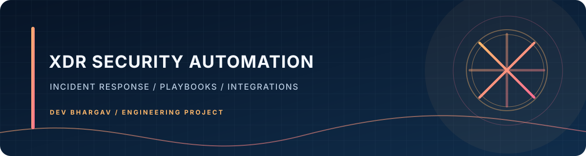
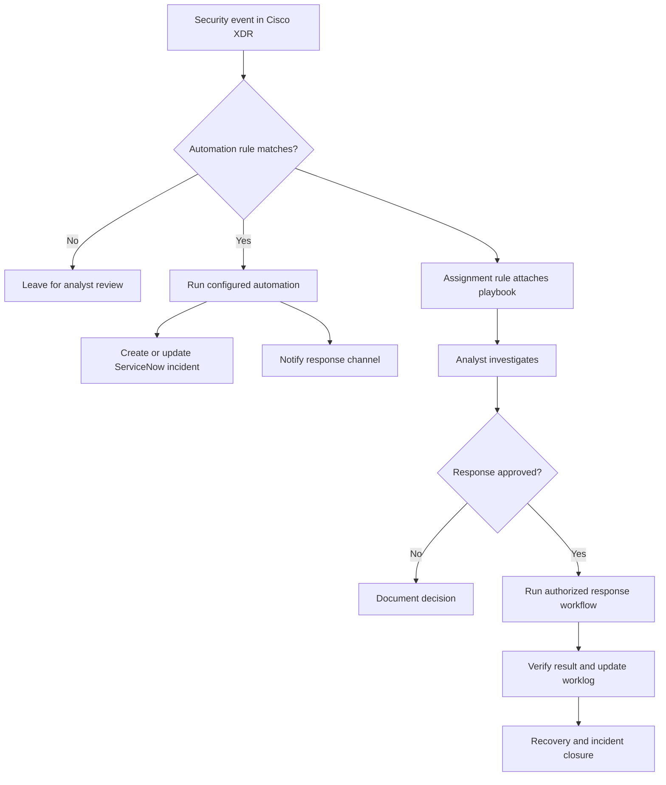

# Cisco XDR Security Automation Lab



A practical Cisco XDR automation repository exploring incident response orchestration, AWS connectivity, ServiceNow ticket workflows, Webex notifications, and analyst-guided containment.

The repository combines implementation experiments with build notes, proof-of-value documentation, workflow diagrams, and a small Python example for the Cisco XDR Automation API.

> **Status note:** AWS and ServiceNow integration work, automation rules, and playbooks are reported as completed in the project context. The EDR containment workflow is still the remaining major implementation milestone. This README does not claim that every documented flow has been tested end to end.

## What this project covers

- **Cisco XDR Automation API:** a Python example for local IP-classification logic and optional workflow API operations.
- **Incident lifecycle:** how an incident can trigger ticket updates, notifications, analyst investigation, and response tasks.
- **ServiceNow:** incident creation/update patterns and avoiding duplicate tickets.
- **AWS connectivity:** architecture and connectivity notes for integrating cloud signals and services.
- **Playbooks and rules:** documented automation paths, human approval gates, and analyst handoffs.
- **Containment design:** documented isolation, verification, and recovery concepts. The EDR containment workflow remains unfinished, so the diagrams describe the intended response path rather than a completed live endpoint-isolation integration.

## Architecture at a glance



This is a logical overview based on the project documentation. Check the build guides and tenant configuration for the actual enabled rules, workflow names, API schemas, and integration status.

## Repository map

| Path | Purpose |
| --- | --- |
| `Automation/hello_xdr_api.py` | Python example for local IP classification and Cisco XDR Automation API calls |
| `tests/test_hello_xdr_api.py` | Unit tests for local logic and the default workflow-start safety guard |
| `AWS/` | AWS architecture, connectivity, and setup notes |
| `XDR Docs/` | Cisco XDR API references, automation build guides, and incident lifecycle notes |
| `HCL Docs/` | Proof-of-value reports and workflow diagrams |
| `docs/ARCHITECTURE.md` | High-level architecture and reliability guidance |
| `SECURITY.md` | Security policy and safe-response principles |

## Quick start: Python example

Requires Python 3.10+ and network access only for API commands.

### 1. Create an environment

Windows PowerShell:

```powershell
py -m venv .venv
.\.venv\Scripts\Activate.ps1
python -m pip install --upgrade pip
pip install -r requirements.txt
```

macOS/Linux:

```bash
python3 -m venv .venv
source .venv/bin/activate
python -m pip install --upgrade pip
pip install -r requirements.txt
```

### 2. Run local tests

```bash
python -m unittest discover -s tests -v
python Automation/hello_xdr_api.py test
```

These commands exercise local logic and do not need Cisco XDR credentials.

### 3. Configure API access

Set these environment variables in your local shell or a private, untracked environment file:

- `XDR_ID`: API client ID
- `XDR_PW`: API client secret/password
- `XDR_TOKEN_URL`: token URL copied from your Cisco XDR tenant's authentication settings
- `XDR_REGION`: `us`, `eu`, or `apjc`, matching your tenant

Example for the current PowerShell session:

```powershell
$env:XDR_ID = "your-client-id"
$env:XDR_PW = "your-client-secret"
$env:XDR_TOKEN_URL = "https://your-tenant-token-endpoint"
$env:XDR_REGION = "apjc"
```

Do not paste real credentials into commits, screenshots, issues, or chat transcripts. Use a dedicated API client with the minimum required scopes.

### 4. List workflows

```bash
python Automation/hello_xdr_api.py list
```

This makes an authenticated API request. It requires valid credentials and the correct token URL, region, and API scope.

### 5. Starting a workflow is guarded

The `run` command validates local input first. Actual workflow execution is disabled unless `XDR_ALLOW_WORKFLOW_START=true` is explicitly set.

Before enabling it, verify the endpoint and request body against the current Automation OpenAPI specification for your tenant. The workflow-start payload in this example is illustrative and must not be assumed to match every tenant/API version.

```powershell
$env:XDR_ALLOW_WORKFLOW_START = "true"
python Automation/hello_xdr_api.py run "Asha" 10.1.2.3
```

Only enable this in a test tenant after confirming the request schema and workflow behavior. A successful HTTP response alone does not prove that the workflow completed successfully.

## Security and operational safeguards

- Use least-privilege API clients and rotate credentials that may have been exposed.
- Keep `.env` files, private keys, tokens, and customer data out of Git.
- Validate event data before rule evaluation and response actions.
- Make ticket creation/update idempotent to avoid duplicate incidents.
- Apply bounded timeouts and retries; do not blindly retry non-idempotent actions.
- Require explicit authorization and target validation before disruptive endpoint actions.
- Record workflow IDs, decisions, timestamps, and outcomes without logging secrets.
- Test against a sandbox or lab tenant before touching production systems.

Read [SECURITY.md](SECURITY.md) before adding live response automation.

## Project roadmap

- [x] Document core incident lifecycle and AWS/XDR integration context
- [x] Add a reproducible Python environment and local test suite
- [x] Add safe defaults and input/configuration validation to the example API client
- [x] Disable workflow start by default until the API request schema is verified
- [ ] Verify API endpoints and request/response schemas against the tenant's current OpenAPI specification
- [ ] Add mocked tests for token retrieval, workflow listing, API failures, and timeouts
- [ ] Add end-to-end tests in a dedicated non-production tenant
- [ ] Complete EDR containment with authorization, device verification, post-action checks, audit evidence, and recovery
- [ ] Add a setup guide that maps every live integration to its exact configuration and required permissions

## Further documentation

- [Architecture and workflow notes](docs/ARCHITECTURE.md)
- [Security policy](SECURITY.md)
- [XDR incident lifecycle](XDR%20Docs/XDR%20Incident%20Lifecycle.md)
- [AWS project notes](AWS/AWS%20Architecture%20Live%20Event%20Ticket%20Platform.md)
- [HCL proof-of-value documentation](HCL%20Docs/)

## Disclaimer

This repository is an educational and defensive security engineering project. Use only systems and tenants you are authorized to access. Review all API scopes, playbook conditions, and approval gates before enabling automated actions. Endpoint isolation and other disruptive operations must have an approved recovery procedure.
