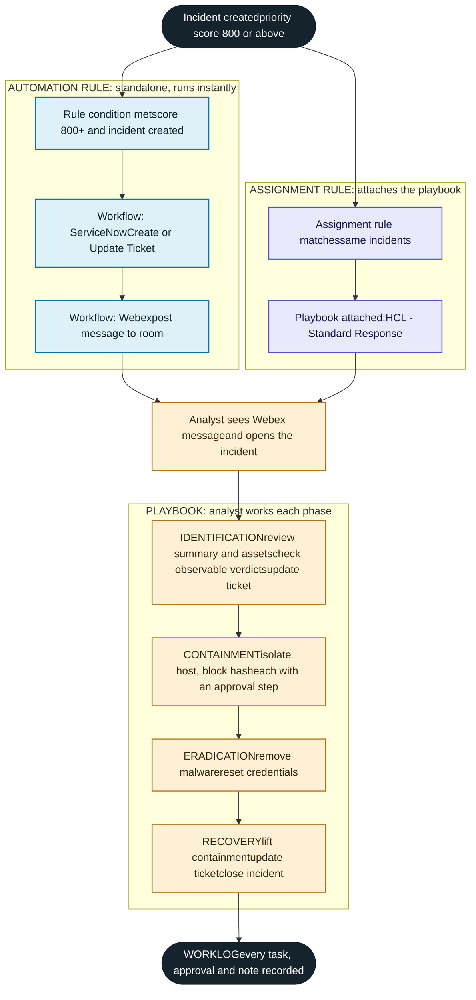
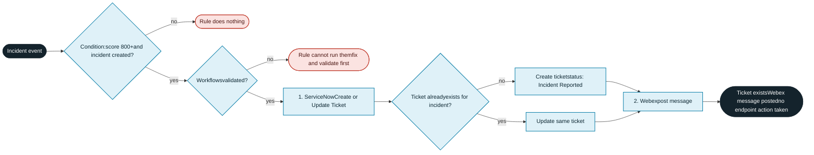
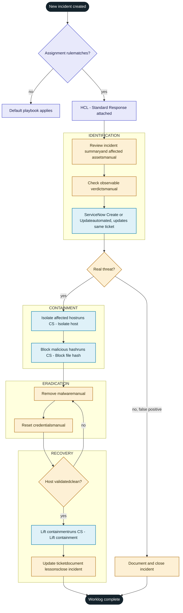
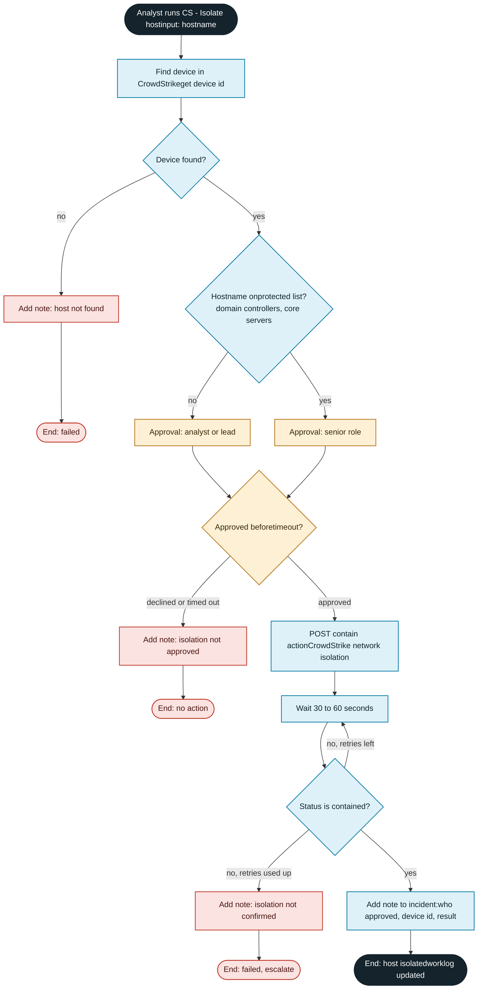
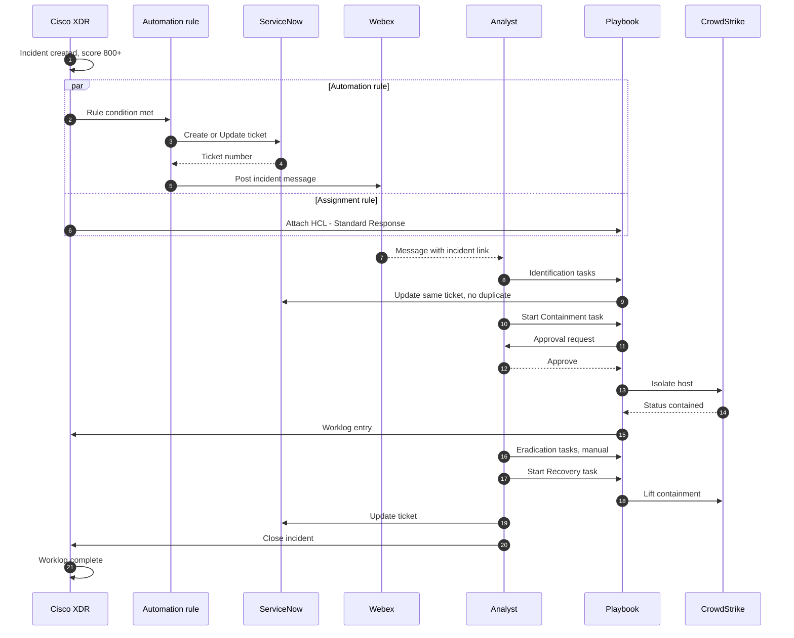

Cisco XDR · HCL proof of value

# XDR Incident Lifecycle

One high-priority incident, two rules, and where the endpoint containment workflow sits. Endpoint tool assumed to be CrowdStrike, as in the build pack.

Automation rule path (instant) Assignment rule and playbook path Needs a person Stops or declined

## 1. Whole lifecycle: creation to closure

Both rules evaluate when the incident is created. The automation rule finishes in seconds. The assignment rule only attaches the playbook, and the analyst then works it to closure.

Ticket and Webex happen with no one clicking. Everything from Identification onward is a person making a call, with XDR running the workflows and keeping the record.

## 2. Automation rule path in detail

What the rule does, in order, and what it leaves alone.

Containment is not in this rule on purpose. A rule fires on a score and cannot wait for approval, so a false positive would isolate a host with nobody checking.

## 3. Assignment rule and playbook path in detail

The assignment rule runs once, at creation. After that the playbook is the analyst's checklist, and containment tasks start workflows with an approval gate.

Blue boxes inside the playbook are workflows that XDR runs when the analyst starts the task. If recovery validation fails, the loop goes back to Eradication instead of lifting containment.

## 4. Containment workflow: Isolate host

This is the new part. The same workflow runs from the playbook task or from the pivot menu on a host in the incident graph.

The hash block (`CS - Block file hash`) follows the same shape with a hash format check first. `CS - Lift containment` uses the same lookup and then the lift action, and is what resets your lab host after each test.

## 5. Who does what, over time

The sequence for one real incident, from the first alert to closure.

## Why the playbook is still needed

|  | Automation rule | Playbook |
| --- | --- | --- |
| Runs | Instantly, once | Across the life of the incident |
| Decides | Only on a condition (score 800+) | The analyst, at each step |
| Manual work | Cannot hold any | Review, eradication, credential resets |
| Approvals | Cannot wait for one | Containment tasks sit behind them |
| Progress | Not tracked | Shows what is done and what is left |
| Evidence | Run history only | Worklog of tasks, approvals and notes |
| Sheet rows it covers | Create a Trigger | Custom Playbook, Lifecycle to Closure, Review Worklog, Complete Containment |

**Two things to watch**

Keep Webex in the rule or the playbook, not both, or the room gets two messages per incident. Assignment rules apply only when an incident is created, so test the full flow with a new incident.